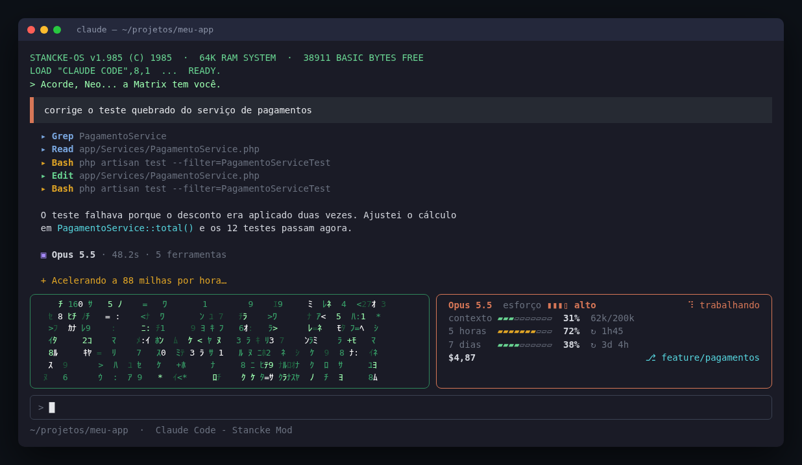

# Stancke Mod para Claude Code

Mod para o [Claude Code](https://claude.com/claude-code) que deixa o terminal com cara retrô/cyberpunk: chat inspirado no OpenCode, chuva de caracteres estilo Matrix, painel com os limites de uso, frases de filmes dos anos 80 no spinner e notificação no desktop quando o Claude termina.



> A imagem é uma reprodução ilustrativa; a chuva Matrix fica animada enquanto o modelo trabalha.

## Funcionalidades

- **Faixa acima do prompt**
  - Chuva de caracteres estilo Matrix, animada enquanto o modelo trabalha e congelada (com uma frase de filme ao centro) quando está ocioso.
  - Painel com modelo atual, nível de esforço, uso do contexto, limites de **5 horas** e **7 dias** (com tempo até reiniciar), custo da sessão e branch git atual.
  - As barras mudam de cor por faixa (verde / amarelo / vermelho) e aparece um toast ao passar de 90% de um limite.
- **Visual do chat**
  - Mensagem do usuário em bloco com barra laranja à esquerda.
  - Resposta do assistente limpa e recuada.
  - Chamadas de ferramenta no formato `▸ Nome  resumo`, com cor por tipo: azul para leitura (`Read`, `Grep`, `Glob`), verde para edição (`Edit`, `Write`), âmbar para `Bash` e roxo para o resto.
  - Fim do turno: `▣ Modelo · duração · N ferramentas`.
- **Spinner** com frases sorteadas: anos 80, Matrix, Ghost in the Shell, Akira, Blade Runner, Tron e De Volta para o Futuro.
- **Boas-vindas** retrô a cada sessão (`STANCKE-OS v1.985 ... READY.`).
- **Rodapé** com o diretório atual e o nome do mod.
- **Notificação no desktop** (Linux, via `notify-send`) quando um turno de mais de 8 segundos termina, com duração, número de ferramentas, modelo e o começo da resposta.
- **Tema claro/escuro** com o comando `/tema-stancke-mod claro|escuro`.

## Instalação

### Direto do GitHub

No `~/.claude/settings.json`:

```json
{
  "enabledPlugins": {
    "stancke-mod@stancke-mods": true
  },
  "extraKnownMarketplaces": {
    "stancke-mods": {
      "source": { "source": "github", "repo": "stancke/stancke-mod" }
    }
  }
}
```

Reinicie o Claude Code.

### A partir de uma cópia local

1. Clone o repositório:

   ```bash
   git clone https://github.com/stancke/stancke-mod.git ~/.claude/mods/stancke-mod
   ```

2. Adicione o marketplace local e habilite o mod no `~/.claude/settings.json`:

   ```json
   {
     "enabledPlugins": {
       "stancke-mod@stancke-mods": true
     },
     "extraKnownMarketplaces": {
       "stancke-mods": {
         "source": { "source": "directory", "path": "/home/<voce>/.claude/mods/stancke-mod" }
       }
     }
   }
   ```

3. Reinicie o Claude Code.

> No Linux, a notificação usa `notify-send` (pacote `libnotify-bin`). Sem ele, o resto do mod funciona normalmente.

## Comandos

| Comando | O que faz |
| --- | --- |
| `/tema-stancke-mod` | Alterna entre tema claro e escuro |
| `/tema-stancke-mod claro` | Força o tema claro |
| `/tema-stancke-mod escuro` | Força o tema escuro |

## Estrutura

```
.claude-plugin/
  plugin.json        # manifesto do mod
  marketplace.json   # marketplace local "stancke-mods"
hooks/
  hooks.json         # aponta para o módulo register.tsx
  register.tsx       # todos os hooks e renderizações
  barra.ts           # formatação de barras, tempos, modelo e esforço
  chuva.ts           # gerador determinístico da chuva Matrix
  *.test.ts          # testes
types/index.d.ts     # tipos do estado do mod
```

## Licença

MIT
